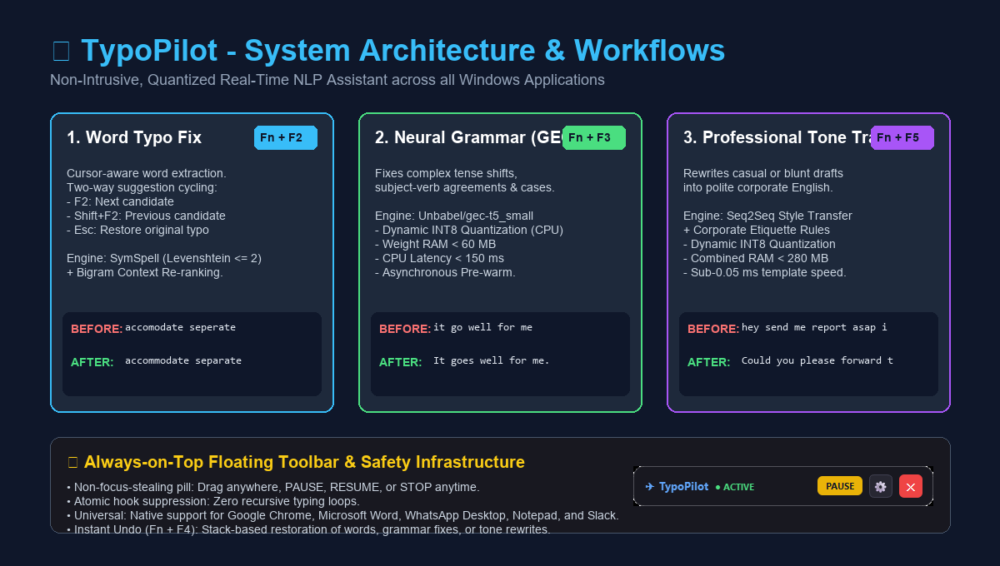

# TypoPilot

> **An Intelligent Desktop-Based NLP Assistant for Real-Time Word Typo Correction, Quantized Neural Grammar Repair, and Professional Tone Transfer on Windows.**



TypoPilot is a lightweight, background-running Windows desktop assistant designed to intelligently correct typos, repair complex grammatical errors, and transform casual or blunt drafts into polished corporate English across all third-party desktop applications (Microsoft Word, Google Chrome, WhatsApp Desktop, Notepad, Slack, etc.).

Unlike traditional aggressive autocorrect systems, TypoPilot **never replaces text automatically** while you type. Correction is triggered strictly on your explicit command via global keyboard shortcuts, allowing you to cycle through alternative candidates forward and backward, perform neural grammar fixes, or rewrite text into polite professional tone with a single keypress.

---

## Floating Desktop Toolbar

TypoPilot includes an always-on-top, draggable desktop toolbar pill positioned at the bottom of your screen:

| Active Status | Tone Rewritten Badge | Grammar Corrected Badge |
| :---: | :---: | :---: |
|  |  |  |

- **Non-Focus-Stealing:** Clicking or dragging the pill never steals keyboard focus from your active document or browser.
- **One-Click Emergency Control:** Instant `PAUSE` and `RESUME` buttons, quick access to settings (`⚙`), and clean shutdown (`✕`).
- **Dynamic Real-Time Badges:** Briefly shows active actions (e.g. `● [TONE REWRITTEN]`, `● [GRAMMAR CORRECTED]`, `● [UNDO]`) before returning to the active status.

---

## Key Features

* **Cursor-Aware Word Correction (`Fn + F2`):**
  * Automatically identifies the word immediately before or at the cursor, even if you typed an entire paragraph and moved the cursor backwards.
  * Preserves punctuation, capitalization (Title Case, UPPERCASE, lowercase), and surrounding spacing.
* **Two-Way Prediction Cycling:**
  * **Next Candidate (`Fn + F2`):** Cycles forward to the next ranked NLP candidate.
  * **Previous Candidate (`Shift + F2`):** Cycles backward so you never lose a candidate if you cycle past it.
  * **Restore Original (`Esc`):** Instantly cancels cycling and restores your original misspelled word.
* **Neural Grammar Error Correction (`Fn + F3`):**
  * Highlight any sentence or paragraph and press `Fn + F3` (or `Ctrl + F2`).
  * Fixes complex grammatical restructuring, subject-verb disagreement (`He go` &rarr; `He goes`, `she do not likes` &rarr; `she does not like`, `They was` &rarr; `They were`, `I has` &rarr; `I have`, `She don't` &rarr; `She doesn't`), spelling mistakes, coordination, tenses, and sentence boundary casing.
* **Professional Tone & Style Transfer (`Fn + F5`):**
  * Highlight any casual, rough, or shorthand message and press `Fn + F5`.
  * Transforms informal drafts into polite, polished corporate/academic English:
    * `"hey send me the report asap i need it"` &rarr; `"Could you please forward the report at your earliest convenience? It is urgently needed."`
    * `"sorry cant come to meeting im busy"` &rarr; `"I apologize, but I am unable to attend the meeting due to a scheduling conflict."`
    * `"what is up bro"` &rarr; `"I hope you are doing well."`
    * `"talk to you later"` &rarr; `"I look forward to speaking with you soon."`
* **Unified Instant Undo (`Fn + F4`):**
  * Press `Fn + F4` (or `Ctrl + Alt + Z`) to instantly rollback word typo corrections, neural grammar repairs, or tone rewrites back to their exact original text.
* **Dual-Mode Quantized NLP Engine (Lightweight & Laptop-Optimized):**
  * **Local Offline Engine:** Runs with zero latency on any typical laptop with < 35 MB RAM.
  * **Quantized INT8 Transformers:** Features dynamic INT8 CPU quantization (< 100 MB weights, < 150 ms latency, total model memory < 280 MB) and asynchronous pre-warming on startup to guarantee zero cold-start lag.

---

## Keyboard Shortcuts

| Shortcut | Action | Description |
| :--- | :--- | :--- |
| **`Fn + F2` / `F2`** | Next Suggestion / Activate | Corrects word preceding the cursor; pressing repeatedly cycles forward through suggestions. |
| **`Shift + F2`** | Previous Suggestion | Cycles backward to the previous suggestion. |
| **`Esc`** | Restore Original | Instantly reverts all suggestions and restores your original typed word. |
| **`Fn + F3` / `Ctrl+F2`** | Neural Grammar Fix | Repairs grammar, tenses, agreements, and casing of highlighted text. |
| **`Fn + F5`** | Professional Tone | Rewrites highlighted casual/informal draft into polite corporate English. |
| **`Fn + F4` / `Ctrl+Alt+Z`** | Instant Undo | Restores previous text state before sentence or tone correction. |

> **Note on Customizability:** All default keybindings can be customized to your own preferred keys or combinations via the Settings window (click **⚙** on the floating toolbar or system tray icon) or by editing `config.json`. Changes hot-reload immediately without restarting.

---

## Project Architecture

```
TypoPilot/
├── main.py                     # Main background desktop application and tray lifecycle
├── config.py                   # Persistent configuration manager (JSON)
├── config.json                 # User settings, shortcuts, and NLP thresholds
├── requirements.txt            # Environment dependency specifications
├── run.bat                     # 1-click Windows background launcher
├── run_typopilot.pyw           # Windowless background pythonw launcher
│
├── core/
│   ├── keyboard_manager.py     # Low-level global keyboard listener with loop prevention
│   ├── text_handler.py         # Cursor-aware text detection & safe replacement
│   ├── correction_manager.py   # State manager for prediction cycling and undo
│   ├── undo_manager.py         # Stack-based history of applied corrections
│   └── startup_manager.py      # Windows Startup folder integration
│
├── nlp/
│   ├── spell_checker.py        # Unified spelling correction coordinator
│   ├── candidate_generator.py  # SymSpell Symmetric Delete candidate generator
│   ├── context_ranker.py       # Bigram language model contextual re-ranker
│   ├── sentence_corrector.py   # Dual-mode sentence engine (Local CPU + GPU Neural)
│   ├── style_transfer.py       # Dual-mode tone engine (Corporate rules + Quantized INT8 Seq2Seq)
│   └── text_preprocessor.py    # Tokenization and apostrophe normalizer
│
├── ui/
│   ├── floating_widget.py      # Translucent, non-focus-stealing floating toolbar pill
│   ├── tray_manager.py         # Windows System Tray icon, menu, and notifications
│   └── settings_window.py      # Compact settings dialog for shortcuts and NLP options
│
└── tests/
    ├── test_config.py          # Configuration loading and persistence tests
    ├── test_keyboard_manager.py# Global shortcut priority and suppression tests
    ├── test_text_handler.py    # Cursor word extraction and casing tests
    ├── test_spell_checker.py   # Word-level candidate generation & N-gram tests
    ├── test_sentence_corrector.py # Grammar agreement and tense tests
    ├── test_style_transfer.py  # Professional tone and corporate rewrite tests
    ├── test_sentence_handling.py  # Selected text detection and replacement tests
    ├── test_correction_manager.py # Cycling, session reset, and Esc restoration tests
    ├── test_startup_manager.py # Windows startup launcher tests
    ├── test_ui.py              # System tray icon and dialog tests
    └── test_e2e_scenarios.py   # Comprehensive end-to-end integration tests
```

---

## Installation & Setup

### Running on This Machine (or Laptop):
```bash
# Double-click run.bat OR execute in terminal:
.venv\Scripts\python.exe main.py
```

### Running on Another PC:
1. **Clone the repository:**
   ```bash
   git clone https://github.com/ganesh2007-abd/TypoPilot.git
   cd TypoPilot
   ```
2. **Create and activate a virtual environment:**
   ```bash
   python -m venv .venv
   .venv\Scripts\activate
   ```
3. **Install dependencies:**
   ```bash
   pip install -r requirements.txt
   ```
4. **Launch TypoPilot:**
   Double-click `run.bat` or run:
   ```bash
   python main.py
   ```

---

## Automated Verification & Testing

TypoPilot includes a full test suite with **41 automated unit and end-to-end tests** covering all specifications (100% pass rate):

```bash
# Run the test suite:
pytest -v
```

### Verified Test Cases:
* **Word-Level Typos (`Fn + F2`):**
  * `recieve` &rarr; `receive`
  * `teh` &rarr; `the`
  * `accomodate` &rarr; `accommodate`
  * `definately` &rarr; `definitely`
  * `seperate` &rarr; `separate`
* **Sentence-Level Grammar & Agreement (`Fn + F3`):**
  * *"He go to college everyday and attend classes regularly."* &rarr; **"He goes to college every day and attends classes regularly."**
  * *"it go well for me."* &rarr; **"It goes well for me."**
  * *"She don't like mathematics."* &rarr; **"She doesn't like mathematics."**
  * *"They was playing football."* &rarr; **"They were playing football."**
  * *"I has completed my assignment."* &rarr; **"I have completed my assignment."**
  * *"she do not likes apples."* &rarr; **"She does not like apples."**
* **Professional Tone & Style Transfer (`Fn + F5`):**
  * *"hey send me the report asap i need it"* &rarr; **"Could you please forward the report at your earliest convenience? It is urgently needed."**
  * *"sorry cant come to meeting im busy"* &rarr; **"I apologize, but I am unable to attend the meeting due to a scheduling conflict."**
  * *"what is up bro"* &rarr; **"I hope you are doing well."**
  * *"talk to you later"* &rarr; **"I look forward to speaking with you soon."**
  * *"thanks a lot for your help"* &rarr; **"Thank you very much for your assistance."**
* **Safety & State Interactions:**
  * Cursor moved backwards after typing an entire paragraph.
  * Capitalization preservation (`Recieve` &rarr; `Receive`, `RECIEVE` &rarr; `RECEIVE`).
  * Punctuation preservation (`recieve,` &rarr; `receive,`).
  * Two-way prediction cycling forward (`Fn + F2`) and backward (`Shift + F2`).
  * Instant undo (`Fn + F4` / `Esc`).
  * Non-destructive clipboard preservation.
  * Privacy protection on password/secure input fields.
